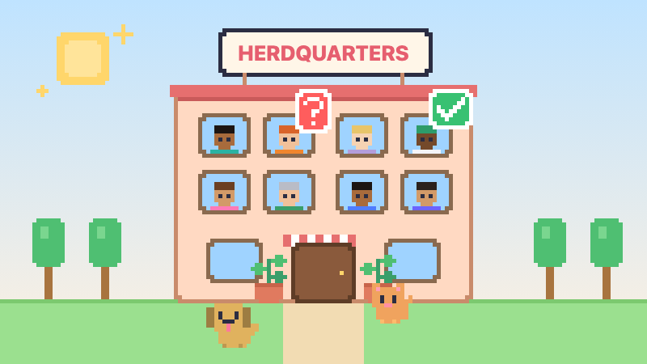
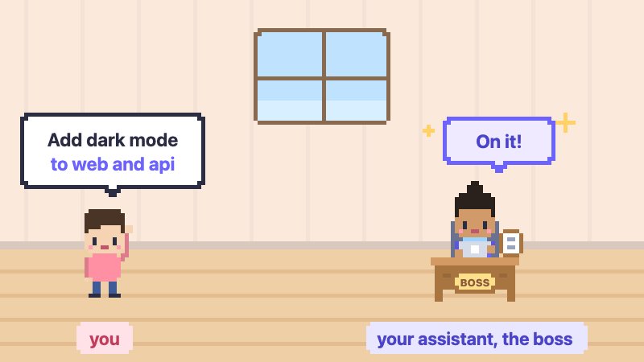
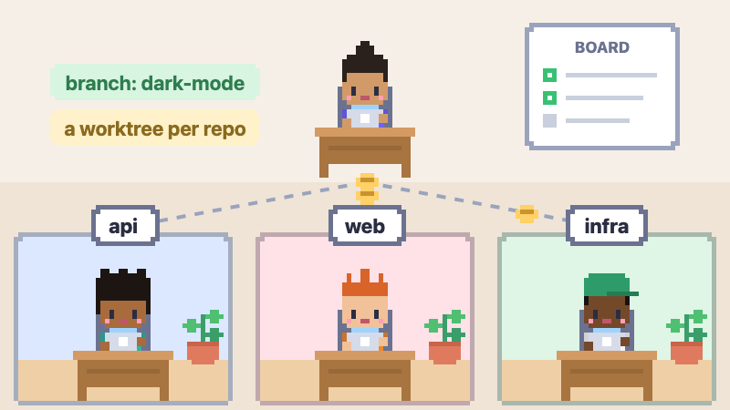
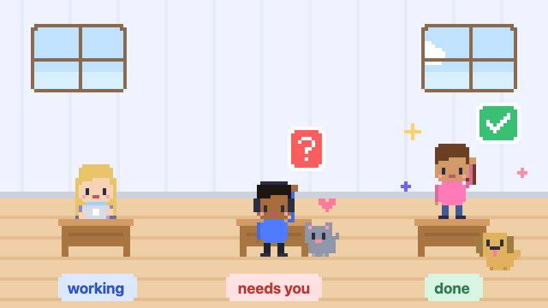
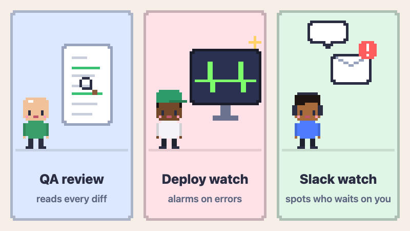
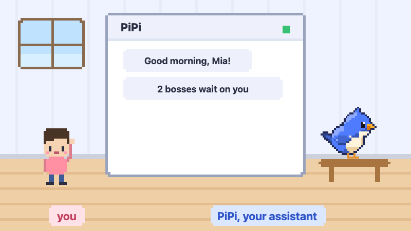

<p align="center">
  
</p>

<h1 align="center">Herdquarters</h1>

<p align="center"><b>Delegate tasks to a team of coding agents and keep track of all of them in one place.</b></p>

Running five agents in five terminals is a lot of tab-switching. Herdquarters
turns them into a small office. You give the work to a boss agent, the boss
hands it out to workers, and you can see at a glance who's typing, who's
waiting on you and who's done. A little bird called PiPi, your assistant,
makes sure you never forget what anyone is waiting for.

It's a desktop app built on [herdr](https://herdr.dev), the agent multiplexer
for your terminal, and works with [Claude Code](https://claude.com/claude-code)
and [Pi](https://github.com/badlogic/pi-mono).

## How it works

### 1. Tell the boss what you need



Create an **orchestrator**: point it at the folder that holds your repos and
give the work a name. You get a **boss**, an agent that acts as your
assistant. Describe the task in plain words, screenshots welcome. The boss
plans it and hands it out, and never edits code itself.

### 2. The boss builds the team



For each repo the task touches, the boss opens a **worker** in its own git
worktree, all on one shared branch. Workers code, run the tests and report
back. The boss keeps a **board** of what's done and what's next.

### 3. Step in only when it matters



| You see | It means |
|---|---|
| Someone typing | working |
| A raised hand and a red **?** | waiting on you: a question or a permission prompt |
| A wave and a green **✓** | done since you last looked |

Questions line up in **reception** at the bottom of the window. Click a desk to
open that agent's terminal right in the app. The office cat goes and sits with
whoever is waiting for you. 🐈

### 4. Helpers on call



- **QA review**: when the work is done, a reviewer reads every diff for
  readability and the repo's patterns, and sends fixes back to the workers.
- **Deploy watch**: say "watch the deploy of #412" and an ops agent follows
  the pipeline, then compares errors and latency with the hour before. If
  something breaks, you get an alert.
- **Slack watch**: a read-only watcher checks the threads and channels you
  care about and tells you when someone is waiting for your answer.

### 5. Meet PiPi, your assistant



A little bird lives in the office. **PiPi** keeps track of what every boss
and Slack need from you, so you don't have to:

- a **morning brief** on weekdays: what waits on you, your meetings and
  reminders
- **reminders**: "remind me at 3 to call Noor", and it chimes on time
- a **memory** of your projects in plain markdown files, tidied up while it
  sleeps

Click the bird to chat. It flies over to a ticket that needs you, celebrates
when one is done, and naps at night. Don't like the name? Call it whatever
you want in **Settings → PiPi**.

## Get started

You need:

- macOS (Linux and Windows are untested)
- [Node.js](https://nodejs.org) 22 or newer
- [herdr](https://herdr.dev)
- [Claude Code](https://claude.com/claude-code) or [Pi](https://github.com/badlogic/pi-mono),
  signed in (the assistant runs on Claude Code)
- [`gh`](https://cli.github.com) for PRs and deploy watching (optional)

```sh
git clone https://github.com/erikedling/herdquarters.git
cd herdquarters
npm install
npm start
```

A short welcome tour opens on first launch. At the end, press
**Create my first orchestrator** and tell your new boss what you need. If
herdr isn't running yet, the app starts it for you.

Already have agents running in herdr? They show up in the **Office** tab right
away: one floor per repo, one room per checkout, one desk per pane.

## Learn more

The [guide](docs/GUIDE.md) covers everything else: terminals and worktrees,
the board, boss instructions, themes, pets and dev flags.

## Develop

```sh
npm test                    # unit tests, plus a few Electron tests
OFFICE_FIXTURE=1 npm start  # a fake office with every pose, no herdr needed
npm run art                 # repaint the README animations
```

Every animation in this README is painted frame by frame on a `<canvas>` by
[`renderer/scenes.js`](renderer/scenes.js), the same scenes the welcome tour
shows, and saved as a looping animated PNG. Change a scene and run
`npm run art` to update them.

## License

[MIT](LICENSE)
